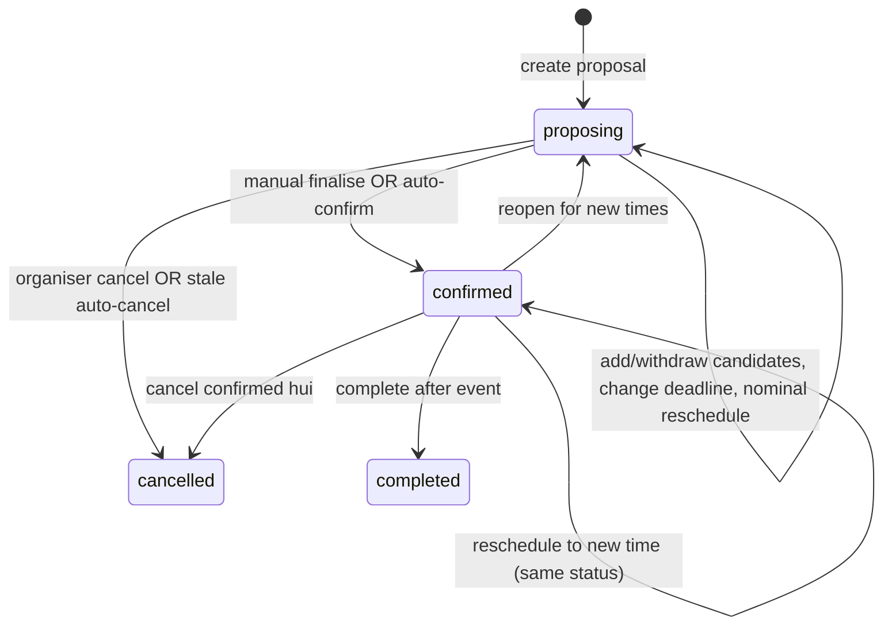

# Hui event lifecycle (coordination)

This document maps **event status transitions**, **who may change them**, **notifications**, and **scheduled jobs**. It reflects production behaviour after the HUI-COORD audit (v0.17.0).

## Status model

| Status | Meaning |
| --- | --- |
| `draft` | Rare; pre-proposal |
| `proposing` | Active planning: proposed times, answers, consensus |
| `voting` / `awaiting_agreement` | Legacy/alternate planning labels (same coordination rules as proposing where used) |
| `reopened` | Planning label used in some flows; treated like proposing for deadlines |
| `confirmed` | Time chosen; attendance on the **selected** candidate stays editable |
| `completed` | Past hui; scheduling locked |
| `cancelled` | Planning abandoned or hui cancelled |

**Candidate** statuses: `proposed` → `selected` (on confirm) or `withdrawn`.

## Transitions

### Proposing → confirmed

| Path | Entry | Locking | Side effects |
| --- | --- | --- | --- |
| **Manual** | `finalise_event(event_id, candidate_id, p_force)` by organiser/admin; `p_force` after UI confirm when rules are not met but ≥1 **Yes** (`yes_count`, not maybe) | `apply_event_confirmation(..., p_force)` shares the same force rules | Selected candidate; `event_confirmed` to all active members **except the actor** |
| **Auto** | `try_auto_confirm_event` after response insert/update when admin veto off | Same `apply_event_confirmation` | Earliest **proposed** candidate that passes `candidate_consensus`; `event_confirmed` to **every** active member (including whoever triggered auto-confirm) |

**Consensus (majority):** requires **≥2 Yes** on that candidate and strictly more than half of active members (Yes only; Maybe does not count). A **solo organiser’s single Yes does not confirm**.

**Race safety:** Manual finalise and auto-confirm share `apply_event_confirmation`. Only one succeeds per event; the other returns false or raises “already confirmed”.

**PGlite tests:** session GUC `hui.skip_auto_confirm=1` disables auto-confirm so tests can drive manual finalise (production leaves it unset).

### Proposing → cancelled

| Path | Entry | Notifications |
| --- | --- | --- |
| **Manual** | `UPDATE events SET status = 'cancelled'` (app action) | `event_cancelled` via `trg_events_member_notifications` (all active members except canceller) |
| **Stale cron** | `process_stale_proposals(as_of, grace_days)` | Organiser nudge `stale_proposal_passed` while nominal date &lt; today &lt; cancel date; after grace, status → `cancelled` and `event_cancelled` per member (cron enqueue + status trigger share the same dedupe key, so members get at most one) |

Nominal date: `planning_target_date` or earliest proposed/selected candidate day (`proposal_nominal_date_for_event`).

### Confirmed → confirmed (reschedule time)

`reschedule_confirmed_event_to_time` — new instants, clears responses, audit row, `event_rescheduled` to engaged members (attendees).

### Confirmed → proposing (reopen)

`reopen_confirmed_event_for_proposing` — withdraws candidates, deletes responses, resets times, new `response_deadline_at`, `event_rescheduled` (reopen copy) to **all active members except the actor**.

### Confirmed stays confirmed

Members may change Yes/Maybe/No on the **selected** time after confirm. Consensus is **not** re-run; dropping out does **not** revert status to proposing.

### Response rules (`responses_before_write`)

- **Cancelled / completed:** no writes.
- **Confirmed:** only the **selected** candidate.
- **Planning statuses:** only **proposed** candidates (withdrawn/past slots cannot receive new answers).
- **Deadline:** after `response_deadline_at`, answers still save but `submitted_late = true`.
- On confirm, `response_deadline_at` is cleared so deadline cron cannot target confirmed hui.

## Notifications (in-app + push when enabled)

| Kind | When | Dedupe prefix |
| --- | --- | --- |
| `event_proposed` | Insert proposing event | `event_proposed:{event_id}` |
| `consensus_ready` | Response makes a candidate pass consensus (while still proposing) | `consensus_ready:{candidate_id}` |
| `event_confirmed` | Status → confirmed | `event_confirmed:{event_id}` |
| `event_cancelled` | Status → cancelled | `event_cancelled:{event_id}` |
| `event_rescheduled` | Reschedule or reopen | `event_rescheduled:{audit_id}` / `event_reopened:{audit_id}` |
| `proposal_deadline_reminder` | Cron ~24h before deadline | `proposal_deadline_reminder:{event_id}:{user_id}` |
| `stale_proposal_passed` | Stale cron, organiser nudge | `stale_proposal_passed:{event_id}` |
| `stale_proposal_auto_cancelled` | Legacy; auto-cancel now uses `event_cancelled` trigger path | — |
| `planning_cycle_opens` | Recurring planning window | `planning_cycle_opens:{group_id}:{nominal}` |
| Host / contribution kinds | Host assignment & contribution changes | per existing migrations |

Push routing is configured in `queue_member_notification` (kind → profile preference).

## Cron / workers

**Route:** `POST /api/internal/planning-cycle/cron` → `runPlanningCycleCron` (`src/lib/groups/planning-cycle-cron.ts`).

| Step | RPC / code | Purpose |
| --- | --- | --- |
| 1 | `refresh_all_group_planning_snapshots()` | Count eligible recurring groups (snapshots recomputed in app) |
| 2 | `refreshAllGroupPlanningSnapshots` | Persist planning cycle snapshots |
| 3 | `enqueue_planning_cycle_nudges(p_as_of)` | “Time to plan” when phase `ready_to_plan` |
| 4 | `process_stale_proposals(p_as_of, grace)` | Stale proposing hui nudge + auto-cancel |
| 5 | `enqueue_proposal_deadline_reminders(p_as_of)` | 24h-before-deadline reminders for **planning** statuses only |

**Push drain:** separate internal route for `notification_push_outbox`.

## App-layer (not exhaustive)

- Stale proposing UI: `stale-proposal-banner`, `reschedule_proposing_event_nominal`.
- Response deadline UI: `response-deadline-manage-form`, `update_event_response_deadline`.
- Confirm-during-save: server action recovery when confirm races an answer save (`confirm-during-save`).

## Related migrations (reference)

- Consensus & finalise: `20261002140000_event_consensus_finalisation.sql`
- Auto-confirm: `20261014113000_hui_auto_confirm.sql`
- Majority ≥2 Yes: `20261014140003`, `20261014140004`
- Deadlines & reminders: `20261013220254_hui_proposal_response_deadlines.sql`
- Stale proposals: `20261013191745_hui_stale_proposals.sql`
- Cancel/reopen notify: `20261014003000_hui_event_cancel_reopen_notify.sql`
- Reschedule/reopen: `20261013194706`, `20261013220000`, `20261013223000`
- HUI-COORD fixes: `20261014210000_hui_coord_lifecycle_audit.sql`
